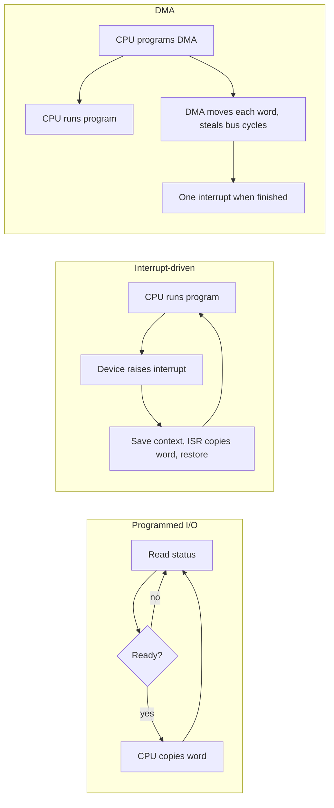

# I/O Data Transfer Simulator

Computer Organization and Architecture (SY CSE), CO5 micro project. Department of Integrated B.Tech, Sanjivani University, Kopargaon.

Topic from the notice: **3. I/O data transfer (programmed I/O, interrupt-driven I/O, DMA)**

| Name | PRN |
|---|---|
| Shraddha Chetan Dolas | 2125UIDF1115 |
| Saish Sandeep Lokhande | 2125UIDM1093 |


## What it does

It moves a block of words from an input device into memory using each of the three methods and shows, cycle by cycle, what the CPU, the device and the DMA controller are doing. The question it answers is the one the topic is about: **how much of the CPU's time does the transfer eat?**

The timeline has one lane per component. You can step through the events one at a time, watch the block diagram light up the components that are active, and read a plain-language description of every event. A comparison table runs all three methods with identical settings so the trade-offs are easy to see.

## The three methods as modelled

**Programmed I/O (polling).** The CPU keeps reading the device's status register. When the device says it is ready the CPU copies the word into memory, then goes back to polling. The CPU does nothing else the whole time.

**Interrupt-driven I/O.** The CPU runs its normal program. When the device has a word it raises an interrupt, the CPU saves its context, runs a short service routine that copies one word, restores its context and carries on. This costs overhead for every word.

**DMA.** The CPU programs the DMA controller once (memory address, word count, direction) and goes back to work. The controller moves each word itself, borrowing the memory bus for a few cycles per word (cycle stealing), and raises a single interrupt at the end.



## The timing model

The device needs `devDelay` cycles to prepare each word, starting when the previous word has been taken.

| Setting | Meaning |
|---|---|
| Words to transfer | size of the block |
| Device delay per word | how slow the device is |
| CPU time to move a word | cost of copying one word to memory |
| One status poll | cost of one status-register check (polling only) |
| Interrupt overhead | entry, context save, restore and return together, per interrupt |
| DMA setup time | CPU time to program the DMA controller |
| DMA bus cycles per word | bus cycles the controller steals per word |

Reported for each method:

* **Total cycles** until the last word is in memory (and, for DMA, the completion interrupt has been handled).
* **CPU useful cycles**: time the CPU spent on its own program during the transfer.
* **CPU useful share** = useful cycles / total cycles.
* Cycles spent **busy-waiting**, **moving data**, on **interrupt or setup overhead**, and **stalled by DMA**. These always add up to the total, and the automatic tests check that.
* Interrupts taken, and throughput in words per 100 cycles.

## What you should see

* With a **slow device**, polling wastes nearly everything (useful share near 0%). Interrupts give a lot back. DMA gives back the most because it takes one interrupt instead of one per word.
* With a **very fast device** and only a few words, polling can actually finish first: the fixed costs of interrupts and DMA setup are not repaid.
* Raising the **interrupt overhead** makes interrupt-driven I/O look worse and DMA better.
* Raising **DMA bus cycles per word** shows the price of cycle stealing: the CPU is stalled for that long on every word.

## Files

```
index.html         page layout
style.css          styling
io.js              the timing model for all three methods (no browser code in it)
app.js             timeline, diagram and tables
tests/io.test.js   automatic checks
```

## Questions you may be asked, with short answers

**Why is polling wasteful?** The CPU spends its cycles asking "ready yet?" instead of running programs, and the device is far slower than the CPU.

**Why is interrupt-driven I/O still not ideal for big transfers?** Each word costs a full interrupt: context save, service routine, restore. For large blocks the overhead adds up.

**What does DMA add in hardware?** A controller with an address register, a count register and the ability to become bus master.

**What is cycle stealing?** The DMA controller takes the bus for single cycles between CPU accesses, so the CPU slows down a little but keeps running. The alternative is burst mode, where the controller holds the bus for a whole block.

**When would you still choose polling?** For very fast devices or very short waits, and in simple systems where the CPU has nothing else to do anyway.

## Assumptions

This is a timing model, not a hardware emulator. The device holds one word at a time. DMA is modelled in cycle-stealing mode only. Interrupt latency is folded into the interrupt overhead figure, and the CPU always has other work available (so "useful cycles" is the work it could do).
## Running it on your own computer

Open `index.html` in any modern browser. Nothing has to be installed and nothing is uploaded anywhere. If your browser blocks something when opening the file directly, run `python3 -m http.server` inside this folder and open `http://localhost:8000`.

To run the automated checks you need Node.js (version 16 or newer): `node tests/io.test.js`

## Putting it on GitHub

1. Create a new **public** repository on github.com (for example `coa-io-data-transfer`). Do not tick "Add a README", you already have one.
2. Upload everything in this folder: on the empty repository page choose **uploading an existing file**, drag all the files and the `tests` folder in, and commit. (Or use `git init`, `git add .`, `git commit`, `git remote add origin ...`, `git push -u origin main` from this folder.)
3. In the repository go to **Settings, then Pages**. Under *Build and deployment* set **Source** to *Deploy from a branch*, pick the `main` branch and the `/ (root)` folder, and save.
4. After a minute or two the simulator is live at `https://<your-github-username>.github.io/coa-io-data-transfer/`. Put that link at the top of this README and in the Google Form.

GitHub's menu labels change from time to time, so if a name above does not match, look for the Pages section under Settings.
